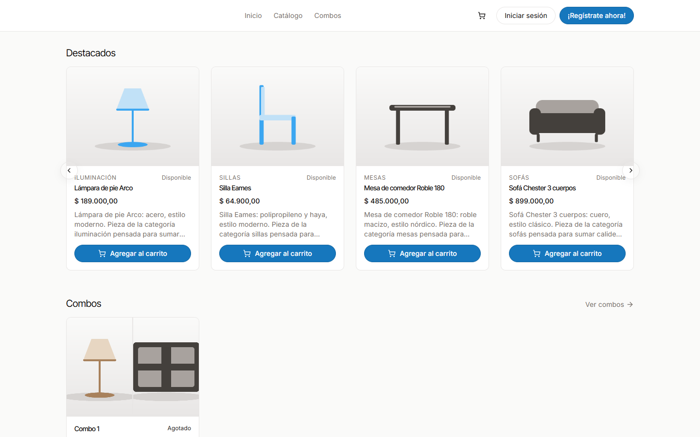
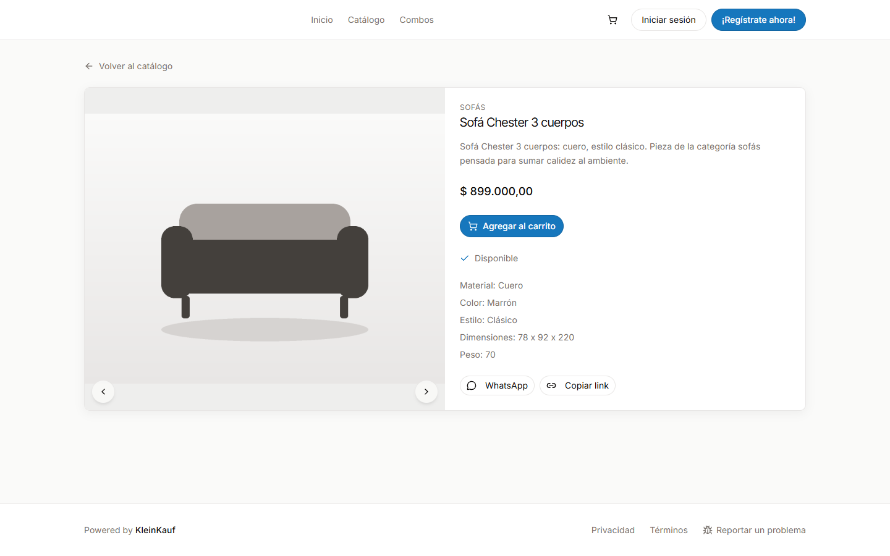
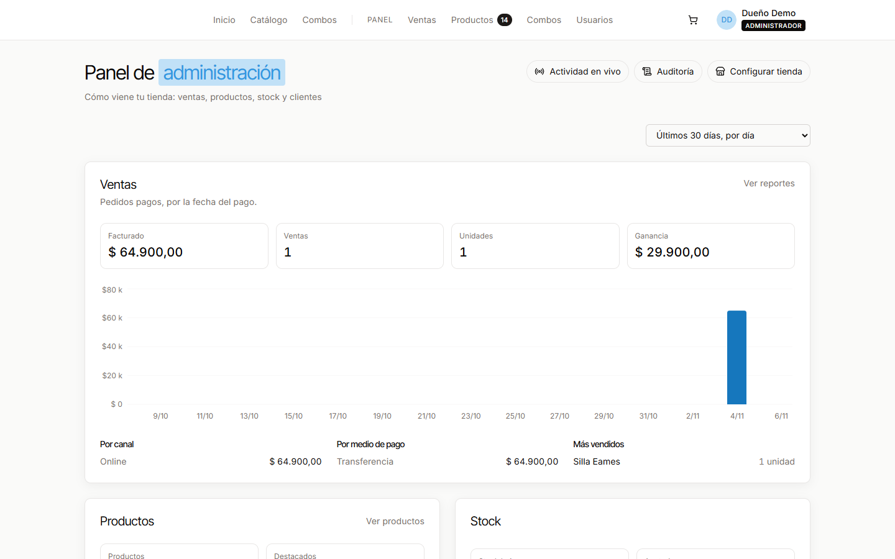
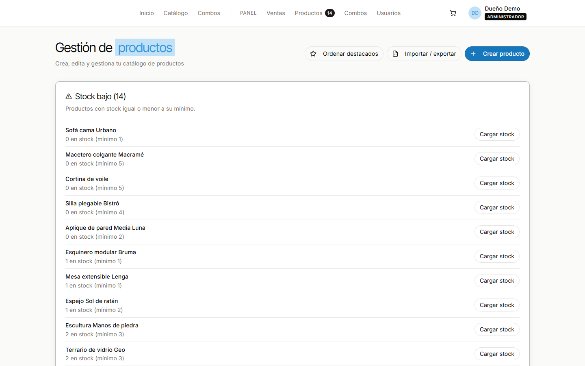
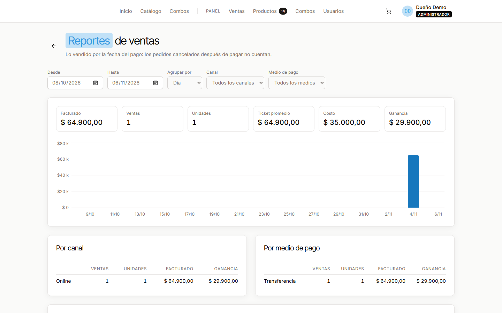
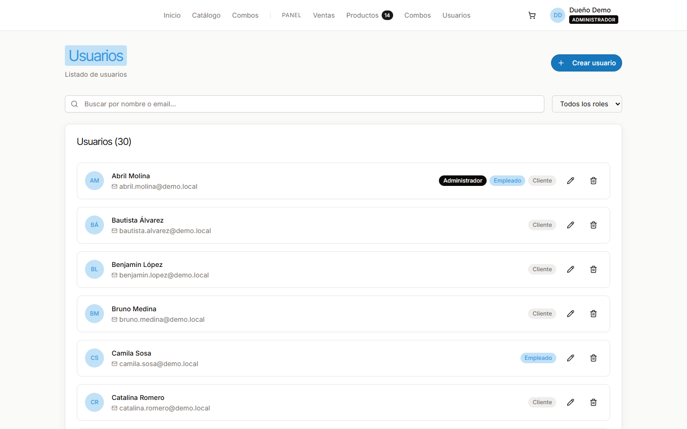
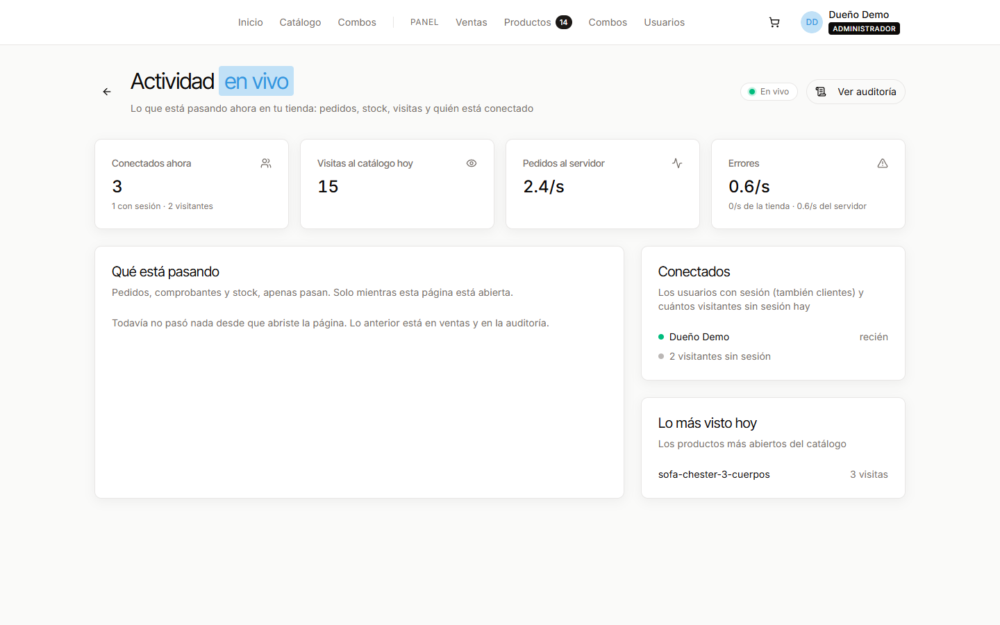
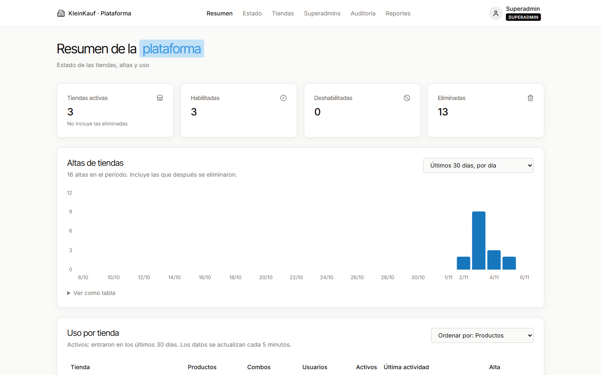
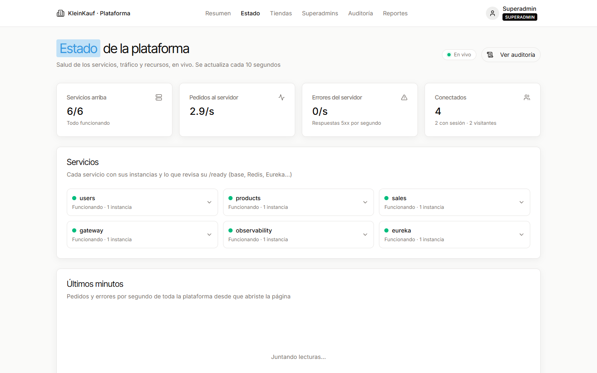
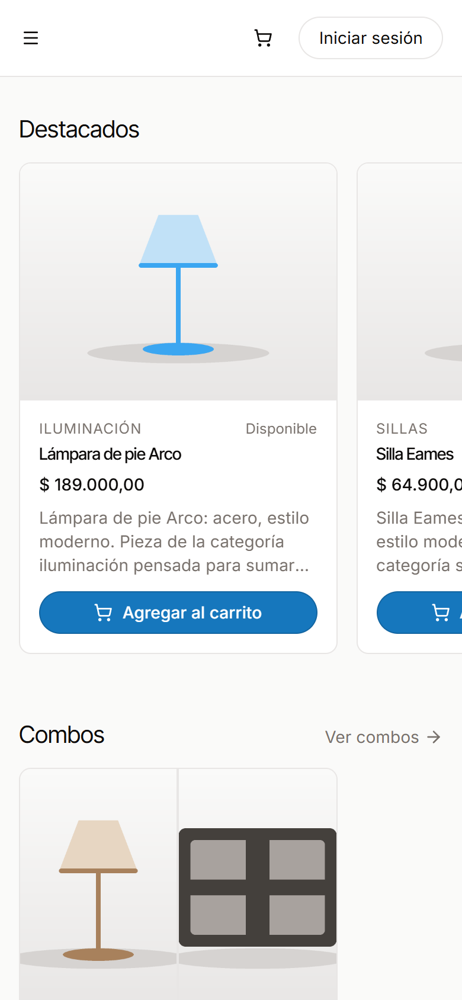

<p align="center">
  
</p>

# KleinKauf

Free management software for small businesses (furniture and home decor shops, for example): an online store with
its own catalog and checkout, plus a back office for products, stock, sales, users and permissions. Every business
gets its own store on its own subdomain, with its own data.

The project has two goals:

- **Try out modern technologies and architectures**: microservices, distributed caching, multi-tenancy, observability.
- **Build a real, free tool** for small businesses that run everything on spreadsheets today.

<p align="center">
  
</p>

## Features

**Storefront** (one per business, at `<store>.<domain>`)

- Home page with featured products and bundles, a searchable catalog and a page per product with share links
  (WhatsApp previews included).
- Cart and checkout as guest or logged in, pick-up or shipping, payment by bank transfer with receipt upload, and an
  order page that follows the payment and delivery.
- Customer accounts, password recovery and email confirmations.
- Each store chooses its name, color theme, icon and social links. SEO-ready: meta tags, sitemap and robots per store.

**Back office** (store owner and staff)

- Products with images, metadata, prices and costs, stock movements with history and low stock alerts, featured
  products, bundles (fixed price or discount) and CSV import/export.
- Orders: validate payments, follow preparation and delivery, record in-store sales, and sales reports by period,
  channel and payment method.
- Users, roles and per-role permissions by area (products, prices, stock, bundles).
- Live activity (orders, stock, visitors) and a full audit log of who changed what.

**Platform** (superadmin)

- Store sign-up and management, usage per store, superadmins, bug reports, and service health, traffic and audit log
  in real time.

## Screenshots

| | |
|---|---|
|  |  |
| **Product page** with availability, details and share buttons | **Store summary**: sales, products, stock and users |
|  |  |
| **Products panel** with the low stock list | **Sales reports** by period, channel and payment method |
|  |  |
| **Users** with their roles | **Live activity**: connected users, visits and traffic |
|  |  |
| **Platform summary**: stores, sign-ups and usage | **Platform health**: services, traffic and resources, live |

<p align="center">
  
</p>

The interface is in Spanish (the target market is Argentina); code and documentation are in English.

## Architecture

```
   Browser ──▶ Frontend (Vite + React) ──▶ Gateway (Spring Cloud Gateway) ──▶ users · products · sales · observability
                                                     │                                   │
                                                   Redis                        PostgreSQL (schema per store)
```

Java 21 and Spring Boot microservices behind a single gateway, service discovery with Eureka, PostgreSQL with one
schema per store, Redis for caching, rate limiting and events, and a React + TypeScript single-page app. Details in
[docs/architecture.md](docs/architecture.md).

## Quick start

Requirements: JDK 21, Node.js 20+ and Docker.

```bash
docker compose -f backend/deploy/docker-compose.dev.yml up -d
```

```bash
cd frontend && npm install && npm run dev
```

Then open the demo store at <http://demo.localhost:2999> (owner: `admin@demo.local` / `demo1234`) or the platform at
<http://localhost:2999> (`superadmin@kleinkauf.local` / `superadmin123`). These are development-only seed users.
Everything else (running without Docker, tests, the end-to-end check) is in
[docs/getting-started.md](docs/getting-started.md).

## Documentation

| Doc | What it covers |
|---|---|
| [Getting started](docs/getting-started.md) | Running locally, seed data and tests |
| [Architecture](docs/architecture.md) | Services, stack, repository layout and branches |
| [Design decisions](docs/decisions.md) | The main decisions and why they were made |
| [Frontend](docs/frontend.md) | Stack, key ideas and every page |
| [API reference](docs/backend/README.md) | One file per service with every endpoint, example and error |
| [Tenants](docs/features/tenants.md) · [Permissions](docs/features/permissions.md) | Multi-tenancy and access control |
| [Sales](docs/features/sales.md) · [Admin dashboards](docs/features/admin-dashboards.md) | Orders, payments, reports and summaries |
| [Observability](docs/features/observability.md) · [Audit log](docs/features/audit.md) | Health, metrics, traces, logs, live panels and auditing |
| [Deployment](docs/deployment.md) · [Email](docs/mail.md) | Server setup, operations and Resend |
| [Style reference](docs/style-reference.md) | The visual style the frontend follows |
| [Next features](docs/next-features.md) · [Server tasks](docs/server-tasks.md) | What is still to be built, and pending server work and technical debt |
