# Architecture

KleinKauf is a set of Spring Boot microservices behind a single gateway, a React single-page app, PostgreSQL with one
schema per store, and Redis for caching, rate limiting and events. Why each piece is the way it is:
[decisions.md](decisions.md).

<p align="center"></p>

Arrows between services are internal calls (`/api/internal/**`, signed token, Resilience4j): sales calls products to
reserve stock, and products and sales ask users for roles.

## Pieces

| Piece | What it does | Port |
|---|---|---|
| **Frontend** (`frontend/`) | Web UI in Vite + React + TypeScript + Tailwind + shadcn/ui: storefront, checkout, store admin panel and platform panel. See [frontend.md](frontend.md) | 2999 |
| **Gateway** (`backend/gateway`) | Single entry point. Validates the JWT, resolves the store, applies CORS and rate limit. Spring Cloud Gateway (reactive) | 3000 |
| **kleinkaufusers** (`backend/kleinkaufusers`) | Authentication (login, sign-up, refresh, password recovery), users, roles, permissions, store sign-up, bug reports and email | 3001 |
| **products** (`backend/kleinkauf-product`) | Products with images, bundles, prices and costs, stock movements, featured products, public catalog, store settings and CSV import/export | 3002 |
| **kleinkauf-sales** (`backend/kleinkauf-sales`) | Online and in-store orders, bank transfer payments and reports | 3003 |
| **kleinkauf-observability** (`backend/kleinkauf-observability`) | Service health and metrics, audit log and real-time panels over WebSocket | 3004 |
| **kleinkauf-common** (`backend/kleinkauf-common`) | Shared library: DTOs, headers, Redis, internal tokens, Hibernate multi-tenancy, filters, observability setup and audit capture | — |
| **Eureka** (`backend/eureka`) | Service registry and discovery | 8761 |

Each service has its own reference, with every endpoint, in [backend/](backend/README.md).

## Design at a glance

- **Multi-tenancy by schema** in PostgreSQL: each store has its own schema in every database, resolved from the
  request's `Origin`. See [tenants.md](features/tenants.md).
- **Two-level cache**: Caffeine (local) + Redis (shared) for tenants, roles and the catalog.
- **Service-to-service calls** go through `/api/internal/**` with a signed internal token, protected by
  **Resilience4j** (circuit breaker, retries and timeouts). Stock reservations are idempotent by order number.
- **Routes**: public API under `/api/v1/**`, platform under `/api/v1/platform/**`, internal under `/api/internal/**`,
  images under `/{resource}/images/{file}`.
- **Permissions by area**, configurable per role in each store (`ADMINISTRADOR`, `EMPLEADO`, `CLIENTE`). See
  [permissions.md](features/permissions.md).
- **Observability**: Actuator on an internal management port, OpenTelemetry traces, JSON logs and, in development,
  Prometheus, Grafana, Tempo and Loki. See [observability.md](features/observability.md).
- **Audit log** with an outbox: no change is lost even if a service goes down. See [audit.md](features/audit.md).

## Stack

- **Backend**: Java 21, Spring Boot 3.5, Spring Cloud (Gateway, Eureka), Spring Security + JWT, JPA/Hibernate,
  Resilience4j, Gradle.
- **Data**: PostgreSQL 17, Redis 8.
- **Frontend**: Vite, React 19, React Router, TanStack Query, TypeScript, Tailwind CSS, Radix UI / shadcn/ui, axios.
- **Infrastructure**: Docker Compose, Caddy (HTTPS), GitHub Actions, Resend (email).

## Repository layout

```
kleinkauf/
├── backend/                      Java microservices (each folder is a Gradle project)
│   ├── gateway/                  API gateway
│   ├── kleinkaufusers/           Users, auth, roles and tenants
│   ├── kleinkauf-product/        Products, stock and catalog
│   ├── kleinkauf-sales/          Sales: orders, payments and reports
│   ├── kleinkauf-observability/  Health, metrics, audit log and WebSocket
│   ├── kleinkauf-common/         Shared library
│   ├── eureka/                   Discovery server
│   └── deploy/                   Docker Compose (database, services, observability stack), init.sql, seed and e2e
├── frontend/                     Web app (Vite + React)
│   ├── src/pages/                Pages: storefront, checkout, account, admin panel and platform panel
│   ├── src/components/           App and UI components (shadcn/ui)
│   ├── src/api/                  Data hooks per domain (TanStack Query)
│   ├── src/lib/ src/hooks/       Auth context, HTTP client, types, texts and hooks
│   └── public/                   Static assets
└── docs/                         Documentation
    ├── features/                 How each feature works across services
    ├── backend/                  API reference, one file per service
    ├── diagrams/                 SVG diagrams and the script that builds them (build.mjs)
    ├── next-features.md          What is still to be built
    ├── server-tasks.md           Pending server work and technical debt
    └── images/                   Screenshots
```

## Branches

- `main`: the whole project (backend + frontend). Work happens here.
- `deploy/backend` and `deploy/frontend`: what runs on the server. A push to either deploys it (see
  [deployment.md](deployment.md)); they are updated by merging `main`.
